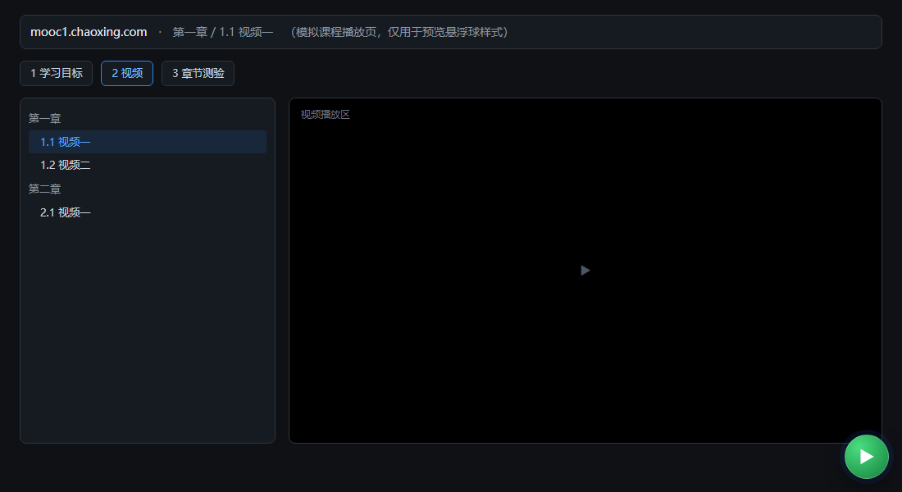
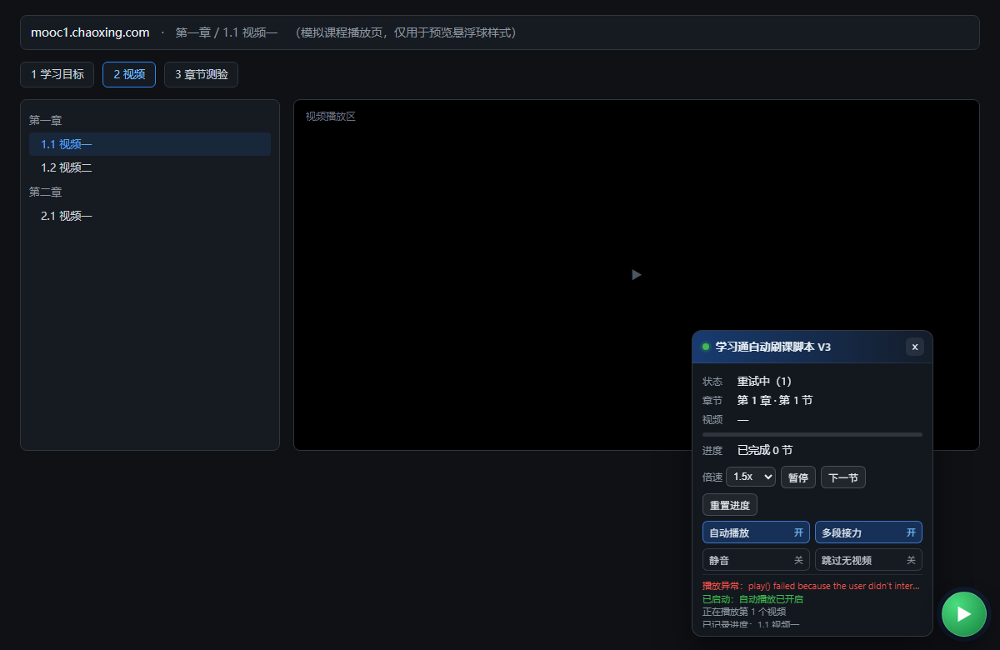
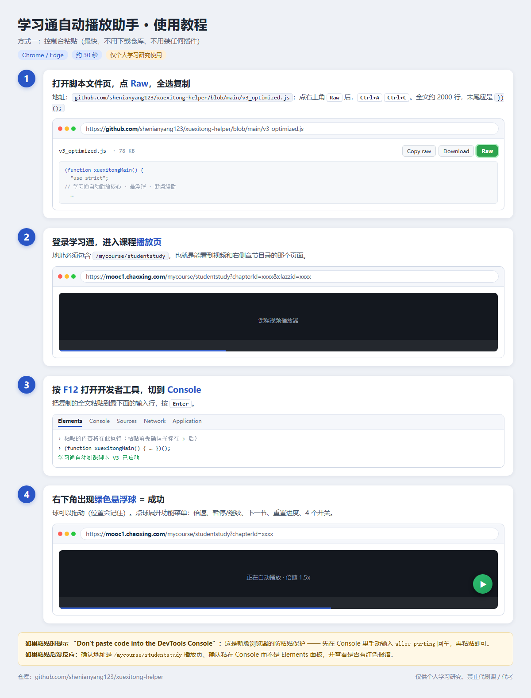
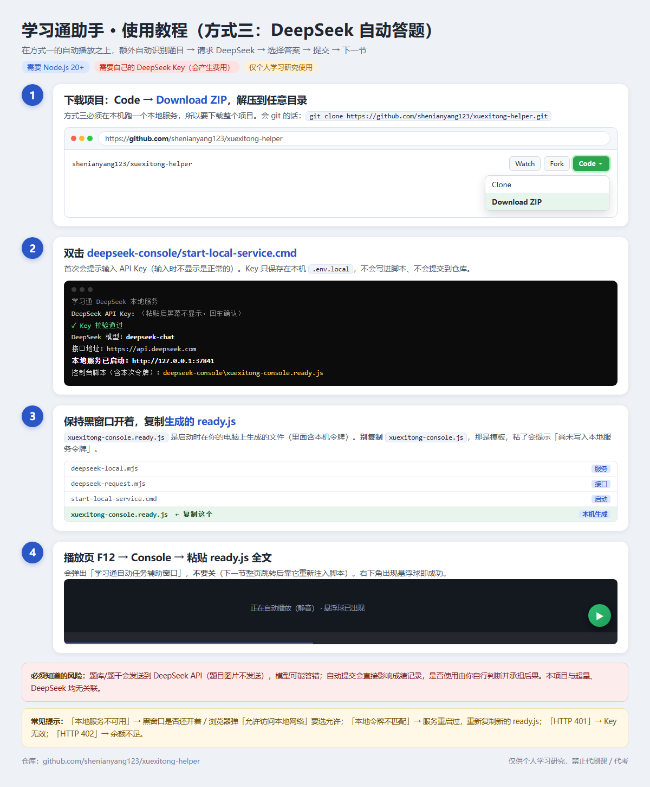

# 学习通自动刷课助手（增强版）

自动播放学习通课程视频、串联同一小节的多段视频、记录断点并在刷新后续播，附带一个右下角的可拖动悬浮球（点开是功能菜单）；另有一个可选的 DeepSeek 章节测验自动作答版本。

无需 jQuery、无需安装任何浏览器插件（控制台粘贴即可用），源码零运行时依赖。

---

## 免责声明

**使用本项目前请务必阅读以下内容；一旦使用、复制或分发本项目的任何代码，即视为你已阅读、理解并同意本声明。**

1. **用途限制**：本项目仅供**个人学习、前端技术研究与自动化脚本调试**使用。严禁用于商业用途，严禁用于代刷课、代考、代做作业等违反校纪校规、平台用户协议或法律法规的行为。
2. **风险自负**：使用本脚本可能修改页面播放状态、自动切换章节、自动提交章节测验答案。由此产生的一切后果（包括但不限于课程进度/成绩异常、学分认定问题、账号被风控或封禁、数据丢失、被学校或平台追责等）**由使用者自行承担**，作者不承担任何直接或间接责任。
3. **无官方关联**：本项目与超星学习通（chaoxing.com）、DeepSeek 官方**没有任何关联**，未获其授权、认可或支持。脚本只操作用户自己浏览器中**已登录**的页面。
4. **合规义务**：请在使用前自行确认你所在学校、课程及平台的规定是否允许此类自动化操作，并自行评估风险。是否使用、如何使用，完全由你自行决定。
5. **数据与隐私**：DeepSeek API Key 由使用者自行申请与付费，仅保存在本机（环境变量 / 本地 `.env.local`），本项目不收集、不上传任何用户数据。
6. **删除承诺**：若相关权利人认为本项目侵犯其合法权益，请联系作者，本项目将立即停止分发并删除相关内容。
7. 本项目按“现状”提供，不附带任何明示或暗示的担保。作者保留随时修改或停止维护的权利。

---

## 功能介绍

悬浮球两种形态：平时只有一个球，点开才是功能菜单。

| 收起（默认） | 点开菜单 |
| --- | --- |
|  |  |

| 功能 | 说明 |
| --- | --- |
| **自动播放** | 识别到视频步骤后自动 `play()`；被页面弹窗、切步骤、播放器重建打断时自动恢复播放（带重试与冷却，避免死循环） |
| **多视频串联** | 同一小节常被拆成多段视频，脚本在 `ended` 后自动寻找下一段未播放的视频继续播，全部播完才切下一节；单小节有上限（默认 8 段）防循环 |
| **断点续播** | 记录「已完成小节 + 每个视频的播放位置」到 `localStorage`；刷新、重开页面、甚至换到另一节课后，自动跳回上次位置并 seek 到对应秒数 |
| **进度记录** | 每完成一节写入进度；`app.progress()` 可查已完成小节列表与续播目标；`app.resetProgress()` 一键清空 |
| **悬浮球菜单** | 右下角圆形球（可拖动、记住位置）：状态、章节、第 n/N 个视频、进度条、已完成节数、最近日志；菜单内含倍速（0.75x–2.0x）、暂停/继续、下一节、重置进度，以及 4 个持久化开关 |
| **设置持久化** | 所有开关、倍速、悬浮球位置/展开状态写入 `localStorage`，下次打开仍然生效；`app.configs.xxx = 值` 直接赋值即持久化 |
| **课程导航** | 自动从「学习目标」切到「视频」步骤；视频播完自动切下一节 / 下一章；纯课件小节默认不跳过（可配置） |
| **章节测验（基础版）** | 遇到章节测验步骤时自动跳过/放行，不阻塞视频推进 |
| **章节测验（DeepSeek 版）** | 自动识别题目、请求本地 DeepSeek 服务作答、按题型选择选项、提交并进入下一节；可选，见 [deepseek-console/README.md](deepseek-console/README.md) |
| **零依赖构建 + 测试** | `src/` 单份源码内联生成三份产物，构建产物可校验一致性；播放核心有 jsdom 单元测试，接口层与本地服务有独立测试（共 31 个用例） |

### 兼容性

- 浏览器：Chrome / Edge（新版），支持直接粘贴到 F12 控制台；也提供 Tampermonkey 版本。
- 本地 DeepSeek 服务：Node.js 20+（开发验证于 Node 24.21）。
- 不依赖页面是否加载了 jQuery。

---

## 目录结构

```text
src/                         源码（构建用，单份真源）
  player-core.js             播放核心：播放、导航、多视频、断点续播、悬浮球菜单、设置
  quiz-automation.js         DeepSeek 章节测验自动作答
  entry-v3.js                V3 入口（控制台 / 油猴）
  entry-console.js           V4 入口（Edge 控制台 + 本地 DeepSeek 服务）
scripts/
  build.mjs                  构建：把 src/ 内联成三份产物
  verify-core.mjs            产物校验：与源码一致 + 语法有效
  build-userscript.mjs       兼容旧命令（委托 build.mjs）
tests/
  verify.mjs                 产物校验入口
  player.test.mjs            播放核心的 jsdom 测试
  deepseek-request.test.mjs  DeepSeek 接口层测试
  local-service.test.mjs     本地 DeepSeek 服务测试
deepseek-console/            DeepSeek 本地服务与 V4 产物
docs/                        截图与图文教程（悬浮球、方式一/方式三步骤图）
v3_optimized.js              【构建产物】控制台直接执行版
v3_optimized.user.js         【构建产物】油猴脚本
```

`v3_optimized.js`、`v3_optimized.user.js`、`deepseek-console/xuexitong-console.js` **都是构建产物，不要直接改**；改源码后重新构建即可。

`deepseek-console/xuexitong-console.ready.js`、`.env.local`、`.local-token` 是**本机运行时生成的文件**（含本机令牌/Key），已被 `.gitignore` 忽略，不会出现在仓库里。

## 构建

```bash
node scripts/build.mjs        # 生成三份产物
node tests/verify.mjs         # 校验产物与源码同步且语法有效
```

`scripts/build-userscript.mjs` 与 `tests/verify-v3.mjs` 仍然可用，内部已委托给上面的新脚本。

---

## 使用方法

三种方式按需选一种即可：**只想要自动播放 → 方式一（连仓库都不用下载，复制一个文件即可）**；长期使用 → 方式二；要自动答章节测验 → 方式三。

### 方式一：浏览器控制台（最快，只要自动播放）

1. 打开 [v3_optimized.js](https://github.com/shenianyang123/xuexitong-helper/blob/main/v3_optimized.js)，点右上角 **Raw**，`Ctrl+A` → `Ctrl+C` 复制全文（约 2000 行，别复制漏了，末尾是 `})();`）；
2. 登录学习通，打开课程播放页（地址含 `/mycourse/studentstudy`）；
3. 按 `F12` 打开开发者工具 → 切到 **Console（控制台）**；
4. 粘贴全文 → 回车；
5. 右下角出现**悬浮球**即启动成功，点球展开功能菜单（球可拖动，位置会记住）。

> 如果控制台提示 `Warning: Don't paste code into the DevTools Console`（新版 Chrome/Edge 的防粘贴保护），先在控制台里手动输入 `allow pasting` 回车，再粘贴。

### 方式二：Tampermonkey（长期使用）

1. 浏览器安装 Tampermonkey 扩展；
2. 打开 [v3_optimized.user.js](https://github.com/shenianyang123/xuexitong-helper/blob/main/v3_optimized.user.js) 点 **Raw**，Tampermonkey 会弹出安装页 → 安装（也可新建脚本后粘贴全文，元数据头已包含）；
3. 打开/刷新学习通播放页，右下角出现悬浮球即生效。

### 方式三：DeepSeek 章节测验自动作答（可选）

> 这个版本需要在本机跑一个 Node.js 本地服务，所以**要把整个项目下载下来**。仓库里**不含** `xuexitong-console.ready.js`，它是启动服务时在你的电脑上生成的（内含本机令牌，不应进仓库）。

1. 准备一个 [DeepSeek API Key](https://platform.deepseek.com/)（需自己有余额）；
2. 下载项目：本页右上角 **Code → Download ZIP** 解压（会 git 的话 `git clone https://github.com/shenianyang123/xuexitong-helper.git`）。本机需已安装 Node.js 20+；
3. 双击 `deepseek-console/start-local-service.cmd`（首次会提示输入 Key，输入时不显示是正常的，Key 只存在本机）；
4. 窗口里会打印生成的 `deepseek-console/xuexitong-console.ready.js` 路径，保持这个黑色命令行窗口开着；
5. 学习通播放页 `F12` → Console → 粘贴 `xuexitong-console.ready.js` 全文（同样可能需要先输 `allow pasting`）；
6. 弹出的「学习通自动任务辅助窗口」不要关，右下角出现悬浮球即成功。

详见 [deepseek-console/README.md](deepseek-console/README.md)。

### 常见问题

| 现象 | 处理 |
| --- | --- |
| 粘贴后没任何反应 | 确认在**控制台 Console** 而不是 Elements/Network 面板；确认地址是 `/mycourse/studentstudy` 播放页；看 Console 有没有红色报错 |
| 悬浮球不见了 | 刷新页面重新粘贴；或控制台执行 `app.showHud(true)` |
| `Warning: Don't paste code...` | 在 Console 手动输入 `allow pasting` 后回车，再粘贴 |
| 双击 `start-local-service.cmd` 一闪而过 / 报 `'xxx' 不是内部或外部命令` | 早期 ZIP 里的 `.cmd` 换行是 LF，cmd.exe 无法解析（现已修复为 CRLF）。重新下载最新 ZIP；临时办法：在 `deepseek-console` 目录执行 `node deepseek-local.mjs` |
| 方式三提示 `本地服务不可用` | 黑窗口是否还开着；浏览器弹「允许访问本地网络」时选允许；杀毒软件是否拦了 `127.0.0.1:37841` |
| 方式三提示 `本地令牌不匹配` / `尚未写入本地服务令牌` | 粘的是 `xuexitong-console.js`（模板）而不是 `xuexitong-console.ready.js`；或服务重启过，重新复制新的 ready 文件 |
| 一直卡在纯课件小节 | 学习通会提示有任务未完成，默认不跳过：确认无需处理后 `app.nextUnit()`，或 `app.configs.autoAdvanceNoVideo = true` |
| 倍速/静音不生效 | 部分课程播放器禁用倍速；V4（方式三）默认静音播放，浏览器自动播放策略要求静音 |

### 图文教程（可保存后转发给别人）

**方式一：控制台粘贴**（30 秒，不用下载仓库）



**方式三：DeepSeek 自动答题**



### 常用命令

```javascript
app.configs.playbackRate = 2;            // 直接赋值即持久化
app.updateSettings({ muteVideo: true }); // 批量修改设置
app.togglePause();                       // 暂停/继续自动播放
app.nextUnit();                          // 手动切换到下一节
app.progress();                          // 查看已完成小节与续播目标
app.resetProgress();                     // 清空进度记录
app.showHud();                           // 展开/收起悬浮球菜单（showHud(true) 强制展开）
app.removeHud();                         // 移除悬浮球（app.updateSettings({ hud: true }) 可恢复）
```

### 设置项

全部可持久化（默认值见下）：

| 设置 | 默认 | 作用 |
| --- | --- | --- |
| `playbackRate` | `1.5` | 播放倍速 |
| `autoplay` | `true` | 是否自动播放 |
| `playAllVideosInSection` | `true` | 同一小节多段视频是否自动接力 |
| `maxVideosPerSection` | `8` | 单小节最多接力多少个视频（防循环） |
| `sectionAdvanceDelayMs` | `4000` | 视频结束后等待新视频出现的最长时间 |
| `muteVideo` | `false` | 是否静音（V4 默认 `true`） |
| `autoResume` | `true` | 是否启用断点续播 |
| `resumePosition` | `true` | 是否记录/恢复视频播放位置 |
| `hud` | `true` | 是否显示悬浮球 |
| `hudCollapsed` | `true` | 悬浮球菜单是否收起（默认只显示球；点球展开后自动置 `false`） |
| `hudPosition` | `null` | 悬浮球位置（拖动后自动写入 `{left, top}`，`null` = 贴右下角） |
| `autoAdvanceNoVideo` | `false` | 无视频小节是否自动跳过（默认关闭，避免课件未完成提示） |
| `keepAlive` | `true` | 页面失焦/切后台时保持播放 |
| `videoCheckInterval` | `1000` | 播放状态检查间隔（毫秒） |
| `guardNoProgressMs` | `7000` | 播放卡住多久后尝试恢复 |
| `retryInterval` / `maxRetries` | `2000` / `10` | 失败重试间隔与次数 |

数据存在三个 key 里：`xuexitong.helper.settings.v1`、`xuexitong.helper.progress.v1`、`xuexitong.helper.positions.v1`。

## 已知行为说明

- **无视频/纯课件小节**：默认不自动跳过（学习通会提示“当前章节还有任务未完成”）。确认该小节无需处理后，可 `app.nextUnit()` 手动跳过，或设置 `app.configs.autoAdvanceNoVideo = true`。
- **`AbortError: play() request was interrupted by a call to pause()`**：页面切换步骤时播放器重新初始化导致的短暂中断，脚本会自动恢复，不是视频损坏。
- **重复日志**：同一页面重复粘贴脚本会叠加监听。脚本会先销毁旧实例再启动新实例，但仍建议刷新后只执行一次。
- **悬浮球菜单里的“重置进度”**：需要连点两次确认，避免误触。
- **悬浮球挡住视频/字幕**：直接拖动球到别处（位置会记住）；或点 `×` 收成球，`app.removeHud()` 可彻底移除。

## 开发

```bash
npm install                   # 仅测试需要（jsdom）
node scripts/build.mjs        # 构建
node tests/verify.mjs         # 产物校验（零依赖）
npm test                      # 构建 + 产物校验 + 单元测试（jsdom / node:test）
```

如果 `npm test` 在某些沙箱环境报 `spawn EPERM`，可改用：

```bash
node --test --test-isolation=none tests/deepseek-request.test.mjs tests/local-service.test.mjs tests/player.test.mjs
```

## DeepSeek 章节测验自动作答

见 [deepseek-console/README.md](deepseek-console/README.md)。它使用同一套播放核心，额外通过本机 `127.0.0.1:37841` 的本地服务调用 DeepSeek；API Key 通过环境变量 / `.env.local` 提供，不会写进脚本文件，也不会改写构建产物。

## 项目来源与致谢

- 本项目基于 [chaolucky18/xuexitongScript](https://github.com/chaolucky18/xuexitongScript) 重构与增强，感谢原作者提供的思路与初始实现。
- 原仓库未声明开源许可证；本仓库在其基础上做了大规模重构（原生 DOM 播放核心、悬浮球、断点续播、DeepSeek 接口层修复、构建与测试体系等）。如原作者或任何权利人认为本仓库的存在不妥，请联系删除。
- 本仓库中的代码同样**不建议**用于任何违反平台协议或校规的用途，详见上方[免责声明](#免责声明)。

## 旧文件

`xuexitong.js`、`v2.js`、`README_v2.md`、`ISSUES_REVIEW.md` 为历史版本与评审记录，已不再维护，仅作参考。
